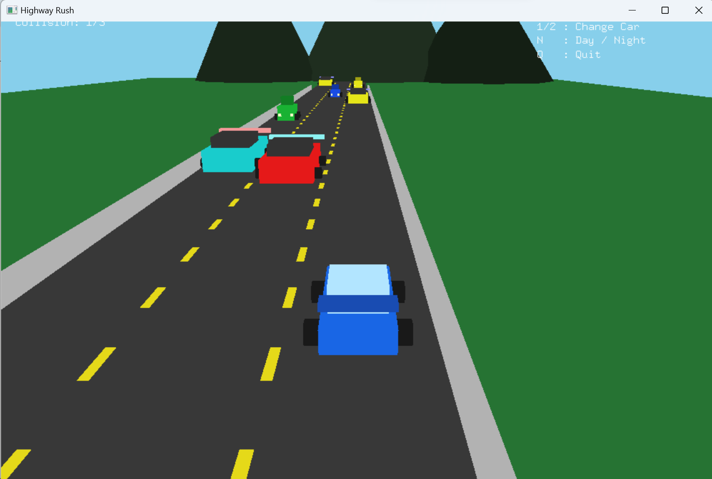

# 🏎️ Highway Rush

A 3D endless highway driving game built with **Python** and **OpenGL (PyOpenGL + GLUT)**. Switch lanes, dodge traffic that keeps getting faster, grab bonus orbs and chase your high score.




Created for my **CSE423 (Computer Graphics)** coursework at BRAC University.

---

## ✨ Features

- **3-lane highway** with smooth lane changes and a perspective camera
- **Endless traffic**: five vehicle sizes in random colours, spawning faster as the game speeds up
- **Speed ramps up over time** (up to ×5.5), so the game gets harder the longer you survive
- **Near-miss bonus**: passing very close to a car gives extra points
- **Mystery orbs**: 50/50 chance of +50 points or a collision
- **3 lives**: the third collision triggers an explosion animation and game over
- **High score** saved to `highscore.txt` between runs
- **Day / night mode**, two player cars and two camera views
- **Pause and restart** at any time

---

## 🎮 Controls

| Key | Action |
|---|---|
| `A` / `D` | Move one lane left / right |
| `P` | Pause / resume |
| `R` | Restart |
| `C` | Switch camera |
| `1` / `2` | Change car |
| `N` | Toggle day / night |
| `Q` | Quit |

Steering into the road edge also counts as a collision.

---

## ▶️ How to Run

1. Install Python 3.
2. From the repository root, run:

```bash
python "First Program/Lets_draw_sth.py"
```

The `First Program/OpenGL/` folder is the PyOpenGL 3.1.7 package provided for the course, including the FreeGLUT DLLs for Windows, so no extra install is needed on Windows. On macOS or Linux, install PyOpenGL and FreeGLUT instead:

```bash
pip install PyOpenGL PyOpenGL_accelerate
# Linux: sudo apt install freeglut3-dev
```

---

## 📁 Project Structure

```text
HighwayRush/
├── First Program/
│   ├── Lets_draw_sth.py     # Highway Rush game (main file)
│   ├── Hello_openGL.py      # First PyOpenGL exercise: draws a point
│   ├── OpenGL/              # Bundled PyOpenGL 3.1.7 (course setup)
│   └── OpenGL.zip           # Same package, zipped
├── screenshot/
│   └── gameplay.png
├── highscore.txt            # Saved best score
└── README.md
```

---

## 🧠 What I Practised

- 3D scene drawing with OpenGL primitives, transformations and `gluPerspective`
- Game loop with GLUT idle and display callbacks
- Axis-aligned bounding-box (AABB) collision and near-miss detection
- Object spawning and despawning, and a scrolling road built from repeating segments
- Simple game states: running, paused, exploding, game over

---

## 👩‍💻 Author

**Shimla** · GitHub: [@shimla50](https://github.com/shimla50)
